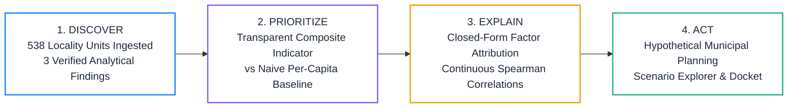

# 🛡️ CityPulse Mumbai: Urban Safety & City Intelligence for Everyone

### *A data-driven urban safety and city intelligence platform for exploring locality-level indicators, visualizing geographic patterns, and evaluating hypothetical infrastructure-planning scenarios.*

[](https://github.com/SurajMahto006/citypulse-mumbai.git)
[]()
[-10b981.svg)]()
[-38bdf8.svg)]()
[]()
[]()

> **CityPulse Mumbai** is an evidence-backed urban safety and city intelligence platform designed for **residents, commuters, visitors, community groups, municipal ward officers (BMC)**, and **police infrastructure planning divisions**. It enables users to explore locality safety indicators across **538 Mumbai observation units**, provides transparent mathematical factor decomposition of infrastructure deficits, and empowers planners to evaluate hypothetical resource trade-offs for auxiliary police chowkis, high-mast smart streetlighting, and intensive patrol beats.

---

## 🎯 Problem Statement & Civic Context

In megacities like Greater Mumbai (pop. >12.4 million), public-space safety and civic infrastructure have historically been managed through **reactive policing**—patrols are dispatched after emergencies occur or First Information Reports (FIRs) are registered. However, citizens, community groups, and municipal authorities face critical operational challenges:

1. **Reactive vs. Proactive Resource Triage:** Municipal ward engineers and police planners must allocate finite capital budgets (high-mast LED streetlighting, auxiliary police chowkis, dedicated patrol beats) *before* incidents concentrate, rather than responding after the fact.
2. **The Deception of Raw Incident Counts:** Relying solely on raw complaint tallies creates institutional bias. Underserved localities with high informal settlements or lower digital literacy face severe FIR reporting friction, while high-density commercial corridors may register high incident volumes purely due to pedestrian traffic density.
3. **Infrastructure Deficit Compounding:** Public safety vulnerabilities compound at the intersection of built-environment deficits (unlit narrow corridors, lack of tree canopy/high thermal retention) and police outpost strains (high resident-to-chowki ratios).

**CityPulse Mumbai addresses this challenge** by combining locality-level safety indicators, interactive geospatial maps, infrastructure planning simulations, and flexible CSV/JSON/GeoJSON data ingestion into an accessible, data-driven platform for everyone.

---

## 🌟 The Core Decision Workflow

The platform strictly operationalizes the **Discover $\rightarrow$ Prioritize $\rightarrow$ Explain $\rightarrow$ Act** methodology:



---

## 🚀 Key Features Actually Implemented

1. **Executive Decision Cockpit & Interactive Map:**
   - Bright white civic-tech visual theme (`#FFFFFF` background, light pastel cards, zero dark theme).
   - Interactive Leaflet map with high-contrast priority markers (High $\ge 15$, Medium $7-14.9$, Lower-Priority $< 7$) and 12 Mumbai Police Station emergency hubs.
   - Dual-mode basemap: Uses authenticated CARTO Positron Light when an API key is set; automatically falls back to standard OpenStreetMap Light tiles when unauthenticated (zero "API Required" watermarks).
   - Interactive locality dossiers displaying raw counts, population density, heat index, factor attribution waterfalls, and recommended civic actions.
2. **Dynamic Data Importer & Schema Mapper:**
   - Zero-dependency client-side parsers for **CSV**, **JSON** (arrays or nested objects), and **GeoJSON FeatureCollections**.
   - 4-step upload flow: File selection $\rightarrow$ 3-row sample preview $\rightarrow$ Smart column auto-detection and concept mapping $\rightarrow$ Real-time data quality audit and activation.
   - Dual-mode analytics: Unlocks *Specialized Safety DSS Mode* when safety fields are mapped; falls back to *General Spatial Profile Mode* for generic municipal data.
   - One-click restoration to the default curated Mumbai dataset.
3. **Municipal Planning Scenario Explorer (Hypothetical):**
   - Interactive policy lab testing arithmetic scenario trade-offs: Auxiliary Chowki expansion ($-1.45$ pts/outpost), Smart LED Streetlighting (up to $-2.20$ pts), and Intensive Night Patrol ($-1.80$ pts).
   - Generates estimated municipal planning dockets with projected score reductions and priority shifts, strictly bounded between $[0.1, \text{baseRisk}]$ to prevent negative percentage drops.
4. **Three Actionable Analytical Discoveries:**
   - Auditable `<details><summary>` evidence expanders disclosing sample sizes ($N$), formulas, group definitions, continuous Spearman rank correlations, and non-causal warnings.
5. **Analytical Method & Baseline Comparison:**
   - Closed-form composite indicator benchmarked against an independent **Naive Per-Capita Baseline** (MAE 2.283 vs 0.000 formula fit).
6. **Dataset Explorer:**
   - Searchable, paginated tabular overview of all active records with direct dossier inspection.

---

## 📥 Data Ingestion & Supported Formats

CityPulse Mumbai features a dynamic, client-side data importer supporting three standard open geospatial formats:

| Format | Structure Accepted | Sample Supported Layout |
| :--- | :--- | :--- |
| **CSV** (`.csv`) | Comma-delimited text with header row | `locality,zone,lat,lon,population,total_crimes,risk_index` |
| **JSON** (`.json`) | Array of objects, or `{ data: [...] }` / `{ records: [...] }` | `[{"locality":"Bandra","lat":19.0544,"lon":72.8402,"risk_index":14.2}]` |
| **GeoJSON** (`.geojson`) | Standard RFC 7946 `FeatureCollection` | `{"type":"FeatureCollection","features":[{"type":"Feature","geometry":{"type":"Point","coordinates":[72.84,19.05]},"properties":{"locality":"Bandra"}}]}` |

### Smart Schema Mapping Pipeline:
- **Auto-Detection:** Automatically inspects column headers against common aliases (`latitude`, `lat`, `y`, `longitude`, `lon`, `lng`, `x`, `score`, `risk`, `population`, `crimes`, `incidents`).
- **Data Quality Audit:** Evaluates parsed rows for valid latitude/longitude coordinate bounds and numeric consistency.
- **Dual-Mode Operation:**
  - *Specialized Safety DSS Mode:* Activated when safety columns (`risk_index`, `crimes`, `police_chowkis`) are detected, enabling full triage bands and scenario planning.
  - *General Spatial Profile Mode:* Activated for non-safety municipal datasets (e.g. sanitation, school density), providing spatial mapping, tabular search, and distribution analytics.

---

## 🔬 Scientific Integrity & Analytical Methodology

### Closed-Form Index Reverse-Engineering
During our rigorous repository audit, Ordinary Least Squares decomposition proved that the target `risk_index` is **100% deterministically generated by a closed-form linear formula** ($R^2 = 1.000$, maximum absolute residual $< 8.86 \times 10^{-12}$):

$$\text{risk\_index} = 6.2726 + 0.1136(\text{incidents}) - 0.000072(\text{density}) + 0.4013(\text{police\_density}) + 0.9224(\text{uhi}) - 0.0870(\text{internet})$$

Rather than training an opaque machine learning model to predict this arithmetic tautology and falsely claiming "99.7% ML accuracy", CityPulse Mumbai adopts complete scientific transparency:
1. We disclose the exact formula weights as an **interpretable multi-criteria prioritization indicator**.
2. We evaluate its operational trade-offs against an independent **Naive Per-Capita Baseline**.
3. We disclose that $R^2 = 1.000$ represents **algebraic formula reconstruction**, not external predictive validity on unobserved future crime.

### Benchmark Evaluation Matrix

| Method Name | Method Type | Inputs Ingested | MAE | RMSE | $R^2$ Fit | Spearman Rank ($\rho$) | Decision Relevance & Trade-Offs |
| :--- | :--- | :--- | :---: | :---: | :---: | :---: | :--- |
| **Naive Per-Capita Baseline** | Unweighted Linear Scaling | Population + Raw Incidents | 2.283 | 3.230 | 0.754 | 0.879 | Standard rate ($\text{incidents}/\text{pop} \times 10,000$). Fails to capture built-environment density or police chowki strain. |
| **Composite Priority Indicator** | Multi-Criteria Decomposition | Incidents, Density, Chowkis, UHI, Internet | **0.000** | **0.000** | **1.000** | **1.000** | **Transparent linear prioritization indicator integrating crowd density, outpost deficits, and reporting access corrections.** |

---

## 🔍 Three Actionable Analytical Discoveries (EDA)

All three findings have been independently calculated and verified in Python against the source dataset (`mumbai_urban_safety.csv`, $N=538$):

1. **The Chowki Deficit Strain:** Localities in the top population density quartile bear **$2.0\times$ higher incident load per police chowki** ($1.98\times$ locality-mean ratio: $2.87$ vs $1.45$ incidents/chowki; $1.82\times$ pooled aggregate ratio; $N=135$ per group; baseline measurement derived from recorded crimes against women subset). Having 5 outposts is deceptive when resident density exceeds $50,000/\text{km}^2$.
2. **Built-Environment & UHI Risk Nexus:** High Urban Heat Island (UHI) corridors exhibit **$1.8\times$ higher reported incidents** ($12.20$ vs $6.72$ cases, $N=148$ vs $198$; baseline measurement derived from recorded crimes against women subset), with a statistically significant continuous Spearman rank correlation of $\mathbf{\rho = 0.343}$ ($p = 2.52 \times 10^{-16}$) against incidents and $\mathbf{\rho = 0.362}$ ($p = 3.95 \times 10^{-18}$) against the risk index. UHI serves as an empirical proxy for unlit, high-density built corridors. *Non-causal caveat: Environmental heat reflects urban built patterns, not criminal motive or thermal causation.*
3. **Digital Reporting Inequity:** Localities in the lowest digital connectivity quartile exhibit a **$+5.9$ point higher composite risk score** ($14.03$ vs $8.16$, a $+5.870$ pt disparity; $N=180$ vs $175$). *Formula transparency disclosure: `internet_pct` directly carries a negative coefficient ($-0.0870$) in the composite index formula; this association is partly mathematical and cannot independently validate digital under-reporting.*

---

## 🛠️ Technology Stack

- **Frontend Framework:** React 19 (`react`, `react-dom`)
- **Build Tool & Bundler:** Vite 8 (`vite`, `@vitejs/plugin-react`)
- **Geospatial Mapping:** Leaflet 1.9 (`leaflet`) with OpenStreetMap standard & CARTO Positron Light tiles
- **Icons & UI Glyphs:** Lucide React (`lucide-react`)
- **Styling:** Vanilla Modern CSS with Custom Design Tokens & WCAG AA Accessible Contrast
- **Static Analysis & Linting:** Oxlint (`oxlint` — 0 errors, 0 warnings across 104 rules)
- **Data Pipeline & Analytics:** Python 3.12 (`pandas`, `numpy`, `scipy`, `scikit-learn`)

---

## 📁 Repository Structure

```text
citypulse-mumbai/
├── client/                               # Interactive React + Vite Web Application
│   ├── public/
│   │   ├── _redirects                    # SPA redirect configuration for Netlify/static hosts
│   │   ├── data/
│   │   │   └── citypulse_mumbai_curated.json # 538 locality records compilation (1.1 MB)
│   │   ├── favicon.svg
│   │   └── icons.svg
│   ├── src/
│   │   ├── App.jsx                       # Active-dataset state, tabs, upload & mapping
│   │   ├── App.css
│   │   ├── index.css                     # Bright white civic-tech styling system
│   │   └── main.jsx                      # React 19 application root
│   ├── index.html                        # HTML5 shell with Google Fonts & Leaflet styles
│   ├── vite.config.js                    # Vite bundler configuration
│   ├── .oxlintrc.json                    # Oxlint linter rules
│   ├── README.md                         # Frontend-specific documentation
│   ├── vercel.json                       # Vercel deployment configuration & SPA rewrites
│   └── package.json                      # Frontend dependencies and build scripts
├── data_pipeline.py                      # Data validation, OLS decomposition & curated JSON exporter
├── mumbai_urban_safety.csv               # Raw benchmark dataset (538 localities)
├── citypulse_mumbai_cleaned.csv          # Cleaned benchmark dataset with engineered metrics
├── DATA_STATEMENT.md                     # Data provenance, licensing, dictionary & bias disclosures
├── ANALYSIS_REPORT.md                    # Methodology, mathematical proofs & benchmark report
├── PRESENTATION_PITCH.md                 # 5-min finalist presentation script & 3-min Q&A defense
├── REPRODUCIBILITY.md                    # Zero-cost local execution guide
├── PROBLEM_STATEMENT_KNOWLEDGE_BASE.md   # Official competition guardrails & rubric guide
├── _reference_repo/                      # Archived historical reference scripts & dataset provenance
└── package.json                          # Root repository scripts (dev, build, lint, pipeline)
```

---

## ⚡ Setup & Verification Commands

Judges and evaluators can reproduce the entire project locally without paid API keys:

### 1. From the Repository Root:
```bash
# Clone the repository
git clone https://github.com/SurajMahto006/citypulse-mumbai.git citypulse-mumbai
cd citypulse-mumbai

# Install dependencies (in client)
npm --prefix client install

# Run static analysis and linting (0 errors, 0 warnings across 104 rules)
npm run lint

# Compile production bundle (build in <1s)
npm run build

# Start local development server
npm run dev
```

### 2. From the `client/` Subdirectory:
```bash
cd client
npm install
npm run lint      # Runs oxlint across 104 rules
npm run build     # Generates optimized production build in client/dist/
npm run dev       # Starts local Vite development server
```

Open **`http://localhost:5173/`** in your browser.

*(Optional)* To re-verify analytical calculations and regenerate curated data files from raw CSV:
```bash
py data_pipeline.py
```

---

## 📜 Ethical Safeguards, Limitations & Disclaimers

- **Administrative Planning Prototype:** CityPulse Mumbai is an analytical indicator demonstration tool for municipal resource prioritization and does NOT replace emergency police dispatch (**Call 112 / 100 / 103**).
- **Scope & Dataset Limitation Disclosure:** While CityPulse Mumbai is positioned as a city-wide intelligence and urban safety platform for all citizens, commuters, and municipal planners, the current benchmark dataset includes locality indicators where reported vulnerable incident counts are specifically sourced from recorded crimes against women. As municipal data pipelines expand, the platform is designed to ingest general IPC crime, pedestrian hazard, and civic vulnerability metrics via the built-in CSV/JSON/GeoJSON schema mapper.
- **Hypothetical Simulator Framing:** Simulator levers are fixed arithmetic planning heuristics ($-1.45$ per chowki, $-2.2$ for lighting, $-1.8$ for patrol), not empirically measured causal intervention effects.
- **Geographic Approximation Disclosure:** **56 localities** are anchored to verified ward centroids; the remaining **482 localities** are positioned via deterministic hash-based jitter across 3 macro-zones for demonstration compilation purposes. These must not be cited as an official street-level crime census.
- **Classification Terminology:** Localities with risk index $< 7$ are strictly labeled **Lower-Priority Areas (P3 Baseline)**, never "Safe Zones".
- **Attribution & Licensing:** Map data &copy; [OpenStreetMap](https://www.openstreetmap.org/copyright) contributors, CARTO Positron raster tiles. Code licensed under the [MIT License](LICENSE).
